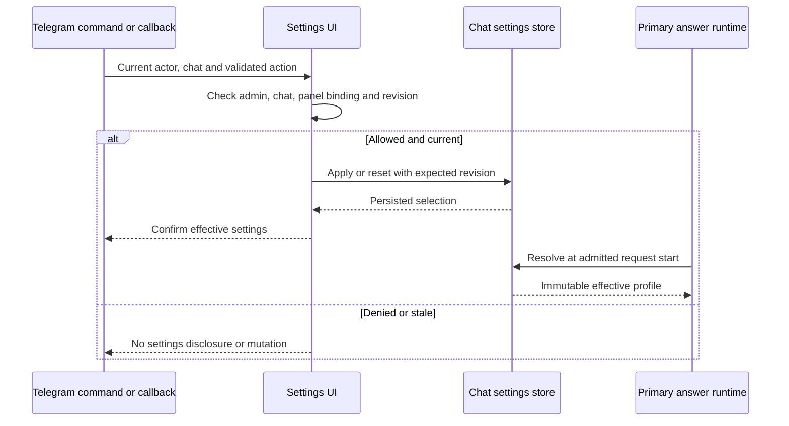

# Chat answer model controls

An existing Aigan administrator can select the primary answer model and reasoning
for the current chat. The selection also covers the chat's topics. It does not
change another chat, global defaults, or auxiliary model roles. The primary
answer can use a paid cloud model or a configured local text model.

[Design](https://github.com/Turkevich91/Aigan/issues/216) ·
[Initial model panel](https://github.com/Turkevich91/Aigan/issues/217) ·
[Tool controls and local answers](https://github.com/Turkevich91/Aigan/issues/219).

## Commands and panel

- `/settings` or `/model` opens the model panel.
- `/select_model astra-low 15m` selects Astra with low reasoning for 15 minutes.
- `/select_model qwen 15m` selects local text generation (`spark` is an alias).
- `/select_model default` removes the override and restores current defaults.
- The panel provides model, supported reasoning, duration, Apply and Reset.
- **Інструменти** opens the independent tool permissions for this chat.
- A selection without an explicit duration lasts 15 minutes. An explicit
  persistent selection lasts until reset.

The panel shows the current effective settings separately from its draft.
Changing a draft does not affect answers until Apply succeeds. A replaced,
expired, restarted or stale panel cannot overwrite a newer saved selection;
open a fresh panel to continue. Commands are deleted on a best-effort basis
after handling; this does not guarantee they were never visible. The panel
does not quote the command. **Закрити** deletes the panel message. Ephemeral
commands and the wider native command catalog are separate work.

The menu lists the cloud models in descending order of standard input and output
price, followed by the local model:

| Alias | Model | Supported reasoning |
| --- | --- | --- |
| `astra` | `gpt-6-astra` | low, medium, high, xhigh, max |
| `sol` | `gpt-6.1-sol` | low, medium, high, xhigh, max |
| `terra` | `gpt-6.1-terra` | none, low, medium, high, xhigh, max |
| `luna` | `gpt-6-luna` | none, low, medium, high, xhigh, max |
| `qwen` | Local Qwen on Spark; no per-token API charge for its answers | Provider default |

Configure the local Chat Completions service through `SPARK_BASE_URL`,
`SPARK_API_KEY` and `SPARK_ANSWER_MODEL`. Keep credentials and deployment
addresses outside the repository. Local answers do not fall back to a paid
model on failure. Qwen is offered for text. Selecting it does not enable
visual inspection of images or video, and is not an account-wide spending
switch: embeddings and other independently configured auxiliary roles do not
move to Spark.

Supported combinations are checked before persistence or inference. The catalog
describes API compatibility; it does not guarantee that an account has model
access, credit or quota. Provider errors must not silently select another model.
The unchanged configured default can still be used when it is outside this
catalog; resetting does not rewrite it.

Capability sources, checked 2026-11-06:
[Terra](https://developers.openai.com/api/docs/models/gpt-6.1-terra),
[Astra](https://developers.openai.com/api/docs/models/gpt-6-astra),
[Sol](https://developers.openai.com/api/docs/models/gpt-6.1-sol),
[Luna](https://developers.openai.com/api/docs/models/gpt-6-luna).

## Tool permissions

Open **Інструменти** to allow or block web search and page reading, YouTube
transcripts, sending public internet images, or random draws independently.
Tapping a tool saves its new permission immediately. A check means the chat
permits it; deployment configuration and the selected model can still restrict
it. The YouTube control reads transcripts, not video frames.

Permissions cover all topics in the current chat and survive restarts, model
changes, model resets and expiry. **Відновити дозволи інструментів** resets
only the tool permissions. If another admin changed them, refresh before
editing. Disabling a tool blocks its next invocation; a side effect already in
progress cannot be recalled.

## State and request behavior

Overrides are stored in SQLite with an absolute UTC expiry and a revision.
Expiry is checked when resolving a request, so it survives process restarts and
does not depend on a sleeping timer. Expiry and reset reveal the current
configured defaults; neither restores an obsolete saved default.

Each admitted primary answer takes an immutable model/reasoning snapshot before
awaited generation work. A new selection or expiry affects subsequent requests,
including a request waiting for the chat's generation lock. It does not change
the middle of a running tool loop. Nested recovery retains the same snapshot.
Provider model, request settings and intended telemetry agree on that selection.

If settings cannot be read, primary answer generation stops before paid routing
or inference. An explicit request receives a short unavailable notice; background
prose is skipped. A storage failure never silently switches a saved inexpensive
selection to the configured default. Diagnostic self-check keeps its separate
operational behavior.

The override includes primary image answers for supported models. Without an
override, the existing interactive image profile remains intact. Background
vision, routing/classification, embeddings, transcription and other auxiliary
work keep their own configured model roles. No re-embedding is required.
Manual selection does not activate automatic model routing.
Requests with a manual override skip the shadow tier experiment; response-stage
telemetry still records the selected model and observed usage.

## Ownership and authorization contract

Each chat has independent model and tool settings. `chat_model_settings.py` owns the supported catalog,
validation, expiry and SQLite revision checks. `chat_model_ui.py` owns the thin
Telegram command/panel adapter. `main.py` owns admission, request snapshots and
propagation through existing model/settings/RunConfig seams. The implementation
uses a separate client for local text answers and reuses the existing memory
database location and admin/chat checks. Prompts and reminder timers do not own settings state.

The operator confirmed administrator-only, current-chat scope for #217.
The policy is specific to these settings controls:

| Actor and scope | Before | Intended behavior |
| --- | --- | --- |
| Configured Aigan admin, admitted current chat | No selection UI | Read panel, select, apply and reset |
| Ordinary admitted member | Receives normal answers | Cannot invoke controls or mutate settings; receives answers under the chat's selected profile |
| Telegram group admin absent from Aigan admin allowlist | No settings authority | No settings authority |
| Admin acting through another user's panel or a different chat | No panel | Denied |
| Missing/bot/anonymous identity, forwarded or edited control | No valid settings action | No mutation |

For callbacks, the actor is `callback_query.from_user`, not the bot-authored
panel message's sender. Recheck the current admin allowlist and chat admission
on every action. A panel nonce is bound to its owner, chat, message, revision
and expiry; the settings store compares the expected revision atomically.
Menu visibility does not grant authorization. A regular panel posted in a group
is visible to its members; the controls remain restricted to the requesting
administrator. It contains model settings, not account or credential details.

Settings controls, captions containing controls, panel replies and confirmation
text must not enter conversation history, embeddings, model input, media caching
or pending-turn assembly. Ordinary group admission and silence stay unchanged.
Provider availability is not required to open/reset settings.

## Verification and limits

Domain tests cover independent chats, persistent expiry, current-default reset,
revision races, malformed selections and supported reasoning. UI tests cover
admin and denied actors, stale/replayed/cross-chat callbacks, draft application
and truthful persistence failure. Runtime regressions cover concurrent requests,
mid-run changes, model/settings/telemetry agreement, unchanged auxiliary roles,
and controls bypassing conversation ingestion.

Native video analysis, billing lookup, ephemeral commands and automatic
provider failover are outside this release. Real Telegram client
appearance and account-specific model access require separate field acceptance;
mocked delivery and offline provider tests do not establish those outcomes.
